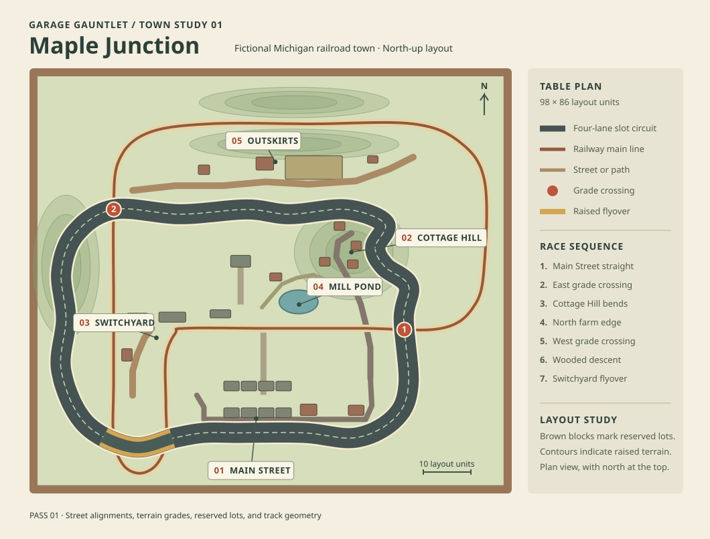

# Maple Junction town master plan

Maple Junction is a fictional Michigan town built around a depot, a lumber spur, and a millpond. In its fictional history, the depot came first. The through-highway became Main Street on the dry ground south of the tracks, workers built cottages uphill to the east, and the town later turned the old millpond into a public park. The modeler fitted four racing slots into the highway surface.

The 98 × 86 layout-unit board keeps the original Switchyard station, freight structures, active railway, crossings, flyover, and wooden benchwork. North is positive Z. The road and rail curves in the overhead drawing come from the playable layout. Smaller rectangles reserve building footprints for later art passes.

| District | Place and purpose | Reserved work |
| --- | --- | --- |
| Main Street | The through-highway doubles as the slot straight. The shops face the highway across curb parking and sidewalks, with a service lane behind them and a civic approach toward the hall. | The diner and hardware store anchor the existing frontage. Theater and filling-station lots extend it east. Complete a coordinated dozen-building block with storefront glazing, street furniture, and pedestrians. |
| Cottage Hill | East of the pond. A winding lane climbs into residential lots while the slot track bends along the ridge. | Individual porches, garage courts, gardens, driveways, leaning fences, sheds, and mailboxes. Keep tall trees behind the racing sightline. |
| Switchyard | The depot, freight sheds, and working railway organize the west side. Freight access comes up from the south. | Warehouse and loading apron, lumber racks, engine servicing, and trackside clutter. Preserve the two active grade crossings and the raised flyover above both sides of the turnaround. |
| Mill Pond | The low ground between the depot and Cottage Hill. A park trail links the civic space to the hillside. | Keep the fishing pier and reserve the picnic shelter, drainage channel, and footbridge. Add ground foam at the banks and a worn path between the shelter and water. |
| Outskirts | The north edge is separated from town by the race route, a service road, and the banks of the railway cutting. | Farmhouse, old barn, field rows, and a grain elevator. A sparse tree line keeps the farmland open and makes the cutting read as a distinct place. |

## Race and camera

The lap starts along Main Street, turns across the east grade crossing, threads the Cottage Hill bends, opens along the farm edge, and crosses the railway again in the northwest. The west ridge leads into a wooded descent, then the car climbs the Switchyard flyover and drops back onto Main Street. The grid camera shows the board and plywood edge, then lowers to an oblique chase view during the countdown. The lower angle must keep the car, throttle warning, and upcoming curve readable.

## Scale and materials

Use the existing rail stock and slot car as the reference pieces. Keep door and figure heights consistent within a district, and repeat a small set of roof pitches, curb heights, sidewalk widths, and storefront bay sizes. The table uses a compressed model-railroad scale so landmarks read at race speed. Treat lot edges as part of the scenery, with footing skirts, gravel, grass, paths, or retaining boards where buildings meet the land. [NMRA layout planning](https://www.nmra.org/node/4368) · [NMRA structures guide](https://www.nmra.org/node/4389)

## Production sequence

1. **Town layout.** Review the overhead map and playable blockout together. Confirm route visibility, hill grades, railway clearance, and the district transitions before replacing study volumes.
2. **Main Street.** Finish one coordinated block. Establish painted plastic, shingle texture, brick weathering, molded seams, and usable exterior lighting. Include a small repair or alteration that shows the modeler has revisited the block over time.
3. **District art and activity.** Extend the same visual scale across town. Start with the station clock, a garage door, and a delivery truck. Add staggered evening lights and a brief passing headlight where the train is visible. Check scene cost and frame pacing in the mobile WebGL build before expanding the animation set.

## Danville, Kentucky reference for Main Street

Use downtown Danville as a reference for the next art pass. Its historic commercial district ties a compact row of brick storefronts to the courthouse at one end and Constitution Square at the other. For Maple Junction, give the highway two short storefront blocks, one cross street, a prominent civic building at one end, and a small green or plaza at the other. Use narrow storefront bays, varied two- and three-story rooflines, recessed doors, upper sash windows, and shared walls. [National Register commercial district nomination](https://s3.amazonaws.com/NARAprodstorage/lz/electronic-records/rg-079/NPS_KY/86000643.pdf)

Use Danville's streetscape for the ground-level details. Group curb parking between corners and leave the crosswalk approaches open. Put the fountain and wider sidewalk where the civic corner meets the highway. Keep the diner and theater close to the sidewalk, with the filling station on the approach where the block opens up. These are adaptations to the miniature board's scale and sightlines. [City of Danville downtown development](https://www.danvilleky.org/513/Downtown-Danville-Development) · [Danville streetscape project](https://danvillekentucky.com/danville-streetscape-project-enhances-downtown-safety-and-beauty/)

Use East Main Street's frame and brick houses as a guide for the transition into Cottage Hill. Behind the commercial blocks, give freight access and service buildings their own working frontage. At the countryside edge, leave more room between structures so the scenery opens up before the next rail crossing. [Danville–Boyle County comprehensive plan](https://www.boyleplanning.org/_files/ugd/a677db_24edb2c04eab47e5b05a3ed7122482ad.pdf)
